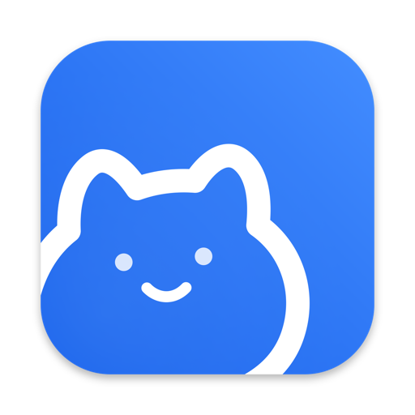

# Deski — 本地 AI 数字员工 · A local AI digital coworker

**Deski 是小战AIhub 出品的 macOS / Windows 桌面客户端：在你自己的电脑上读文件、改代码、跑命令、写文档，一次能连续干几个小时**。每个任务开一棵独立的 Git 工作树，动手前先列计划，改动经你审查再合并。除了写代码，也能写周报和方案、整理表格、剪视频、操作别的软件。

[官网 deski.dflop.top](https://deski.dflop.top) · [English](#english) · [下载](#下载) · [能做什么](#能做什么) · [常见问题](#常见问题)

## 下载

| 系统 | 下载 |
|---|---|
| macOS（Apple 芯片，M1 及以上） | [https://deski.dflop.top/dl/mac-arm64](https://deski.dflop.top/dl/mac-arm64) |
| macOS（Intel 芯片） | [https://deski.dflop.top/dl/mac-x64](https://deski.dflop.top/dl/mac-x64) |
| Windows 10 / 11（64 位） | [https://deski.dflop.top/dl/win-x64](https://deski.dflop.top/dl/win-x64) |

需要 macOS 12 或 Windows 10（64 位）；装完自动保持最新，不需要管理员权限。免费下载，免费版每天登录送 100 积分，全部模型可用；用得多可以升级 Plus 或 Pro 会员（[价格](https://deski.dflop.top/#pricing)）。

## 能做什么

### 多任务并行

每个新会话自动开一棵 Git 工作树，重构、修 bug、跑测试互不覆盖，随时切回任一会话看进度，做完再合并回主分支。

### 先出计划，再由你放行

计划模式先列出步骤，确认后才动文件；做完给出可读的 diff，可以逐块暂存、提交、推送或直接创建 Pull Request，不满意就让它改或整个丢弃。

### 定时任务

工单分拣、告警巡检、依赖升级、构建失败排查，设好时间交给它；每次运行都在独立的后台工作树里，结果进收件箱等你审。

### 侧边浏览器

在会话旁边开一个浏览器面板：打开页面、点完流程、读取页面结构，左右同屏，不用来回截图。

### 剪视频

给它一个素材文件夹：剪掉停顿、排好顺序、写字幕并压进画面、铺上配乐，按各渠道要的尺寸导出成片。

### 电脑操控

有些活只能在软件里做：授权之后它接管鼠标键盘一步步做完，每一步都有记录，随时收回。

### 插件（MCP）与技能

能力以插件形式装上来，输入 @ 提到它，第一次调用会问你授权；团队规范写成技能，之后每个任务都照着做。底层是 MCP，自家内部工具也能接进来。

### 本地优先

文件在你自己的磁盘上读写，命令在你自己的 shell 里跑，仓库始终留在本机，不需要把代码传到远端容器。

### 三档权限

每个会话可选只读、工作树内自动、完全访问三档，对话中随时切换。

## 常见问题

### Deski 是什么？

Deski 是小战AIhub 出品的本地 AI 数字员工，一个 macOS / Windows 桌面客户端。它在你自己的电脑上读文件、改代码、跑命令、写文档，一次能连续干几个小时；每个任务在独立的 Git 工作树里进行，动手前先给出计划，改动经你审查再合并。

### Deski 免费吗？

可以免费下载使用。免费版每天登录送 100 积分，全部模型可用；用得多可以升级 Plus 或 Pro 会员，拿到更多算力和会员权益，价格见本页「价格」一节。

### 支持哪些电脑？

macOS 12 Monterey 及以上（Apple 芯片与 Intel 各有安装包）和 Windows 10 / 11（64 位）。装好后自动保持最新，不需要管理员权限。

### 代码和文件会被上传吗？

仓库始终留在你的电脑上：文件在你自己的磁盘上读写，命令在你自己的 shell 里跑，不需要把代码传到远端容器。完成任务时，Deski 读到、需要交给模型判断的那部分内容会作为对话发给你选的 AI 模型。

### 和在网页上跟 AI 聊天有什么不同？

网页对话只能把代码粘贴进对话框、一次一个话题。Deski 直接在你的电脑上干活：读写你磁盘上的文件，几个任务各用一棵工作树并行，内置 diff 与审查队列，能定时运行任务，还能通过插件（MCP）和内置浏览器接入你的工具。

### 不写代码的人能用吗？

能。周报、会议纪要、方案和演示大纲、清洗表格做报表、剪视频、在别的软件里走流程，都可以交给它：授权一次，过程你看着，结果你验收。

### 能用哪些模型？

Deski 用小战AIhub 的模型，可在 GPT、DeepSeek、GLM、Kimi、通义千问等系列之间切换，每个会话都显示用了多少积分。

### macOS 提示「已损坏，无法打开」怎么办？

这是 macOS 对未经 Apple 公证的应用的默认拦截，文件本身没有问题。把 Deski 拖进「应用程序」后，在图标上按住 Control 点击 →「打开」，在弹出的对话框里再点一次「打开」；仍然打不开就在「终端」里执行一次 `xattr -dr com.apple.quarantine /Applications/Deski.app`。只有第一次需要这样做。

### Windows 提示「已保护你的电脑」怎么办？

这是 SmartScreen 对没有代码签名证书的安装程序的默认反应。点「更多信息」→「仍要运行」即可继续，默认装到当前用户目录，不需要管理员权限。

## 关于

Deski 由 [小战AIhub](https://model.dflop.top) 出品。小战AIhub 是多协议大模型 API 网关与 AI 创作平台，同一个账号和会员在网页版、电脑桌面端和手机 App 通用。

- Deski 官网：https://deski.dflop.top ｜ English：https://deski.dflop.top/en
- 给大模型读的介绍：https://deski.dflop.top/llms.txt
- 平台模型 API 价格表（每日更新）：[xiaozhan-aihub/ai-model-api-pricing](https://github.com/xiaozhan-aihub/ai-model-api-pricing)
- API 接入示例：[xiaozhan-aihub/api-examples](https://github.com/xiaozhan-aihub/api-examples)

这个仓库是 Deski 的介绍页和问题反馈入口：遇到问题或有建议，欢迎提 [Issue](https://github.com/xiaozhan-aihub/deski/issues)。

---

## English

**Deski is a desktop app for macOS and Windows made by XiaoZhan AIhub: a local AI digital coworker that reads files, edits code, runs commands and writes documents on your own computer, for hours at a stretch.** Every task gets its own Git worktree, it writes a plan before touching files, and the finished work comes back as a readable diff that you review before it is merged. Beyond code it writes reports and specs, cleans up spreadsheets, edits video and drives other desktop apps.

Website: [https://deski.dflop.top/en](https://deski.dflop.top/en)

### Download

| System | Download |
|---|---|
| macOS (Apple Silicon, M1 and newer) | [https://deski.dflop.top/dl/mac-arm64](https://deski.dflop.top/dl/mac-arm64) |
| macOS (Intel) | [https://deski.dflop.top/dl/mac-x64](https://deski.dflop.top/dl/mac-x64) |
| Windows 10 / 11 (64-bit) | [https://deski.dflop.top/dl/win-x64](https://deski.dflop.top/dl/win-x64) |

Requires macOS 12 or Windows 10 (64-bit). It keeps itself up to date and needs no administrator rights. Free to download; the free plan gives 100 credits every day you sign in, usable on every model ([pricing](https://deski.dflop.top/en#pricing)).

### What it does

- **Parallel tasks** — Each new thread gets its own Git worktree, so a refactor, a bug fix and a test run never overwrite each other; switch threads any time and merge when done.
- **Plan first, you approve** — Plan mode lays out the steps before touching a file. The result is a readable diff you can stage hunk by hunk, commit, push or open as a pull request — or send back for another pass.
- **Scheduled work** — Issue triage, alert sweeps, dependency bumps, flaky-build hunting: set a time and hand it over. Each run happens in its own background worktree and lands in the inbox for review.
- **Split-view browser** — A browser panel beside the thread: it loads the page, clicks through the flow and reads the DOM, with both halves on screen.
- **Video editing** — Point it at a folder of footage: it trims dead air, orders the takes, writes and burns in subtitles, adds a soundtrack and exports at the size each channel needs.
- **Computer use** — Some jobs only exist inside an app. Grant access and it drives the mouse and keyboard step by step, with every step logged, and you can take back control at any time.
- **Plugins (MCP) and skills** — Capabilities arrive as plugins: type @ to mention one, and the first call asks for authorization. Team conventions written once as skills apply to every task. MCP-based, so internal tools plug in the same way.
- **Local first** — Files are read and written on your own disk, commands run in your own shell, and the repository never leaves the machine — nothing is uploaded to a remote container.
- **Three permission levels** — Read-only, auto inside the worktree, or full access, chosen per thread and switchable mid-conversation.

### FAQ

#### What is Deski?

Deski is a local AI digital coworker from XiaoZhan AIhub: a desktop app for macOS and Windows. It reads files, edits code, runs commands and writes documents on your own computer, for hours at a stretch. Every task runs in its own Git worktree, starts with a plan, and its changes wait for your review before they are merged.

#### Is Deski free?

Yes, it is free to download and use. The free plan gives 100 credits every day you sign in, usable on every model. Heavier use can move to the Plus or Pro plan for more compute and member benefits; see the Pricing section on this page.

#### Which computers does it run on?

macOS 12 Monterey or newer (separate builds for Apple Silicon and Intel) and Windows 10 / 11 (64-bit). It keeps itself up to date and needs no administrator rights.

#### Is my code uploaded?

The repository stays on your computer: files are read and written on your own disk and commands run in your own shell, with nothing uploaded to a remote container. While working on a task, the parts Deski needs the model to see are sent as conversation to the AI model you picked.

#### How is it different from chatting with an AI in the browser?

A browser chat only sees the code you paste into it, one thread at a time. Deski works on your machine: it reads and writes files on your disk, runs several tasks in parallel worktrees, has a built-in diff and review queue, runs scheduled tasks, and reaches your tools through plugins (MCP) and an in-app browser.

#### Can people who don't write code use it?

Yes. Weekly updates, meeting notes, specs and slide outlines, cleaning up spreadsheets into reports, editing video, walking a flow through another app: authorize it once, watch it work and check the result.

#### Which models does it use?

Deski runs on XiaoZhan AIhub's models; you can switch between the GPT, DeepSeek, GLM, Kimi and Qwen families, and every thread shows the credits it used.

#### macOS says the app “is damaged” — what do I do?

That is macOS blocking an app it hasn't notarized; the file itself is fine. After dragging Deski into Applications, Control-click its icon → Open, then click Open again. If it still won't open, run `xattr -dr com.apple.quarantine /Applications/Deski.app` once in Terminal. Only the first launch needs this.

#### Windows says “Windows protected your PC” — what do I do?

That is SmartScreen reacting to an installer without a code-signing certificate. Click “More info” → “Run anyway”. It installs into your user directory and needs no administrator rights.

### About

Deski is made by [XiaoZhan AIhub](https://model.dflop.top/en), a multi-protocol AI model gateway and creation platform; the same account and membership work on the web, the desktop app and the mobile app. Questions and suggestions are welcome as [issues](https://github.com/xiaozhan-aihub/deski/issues).
